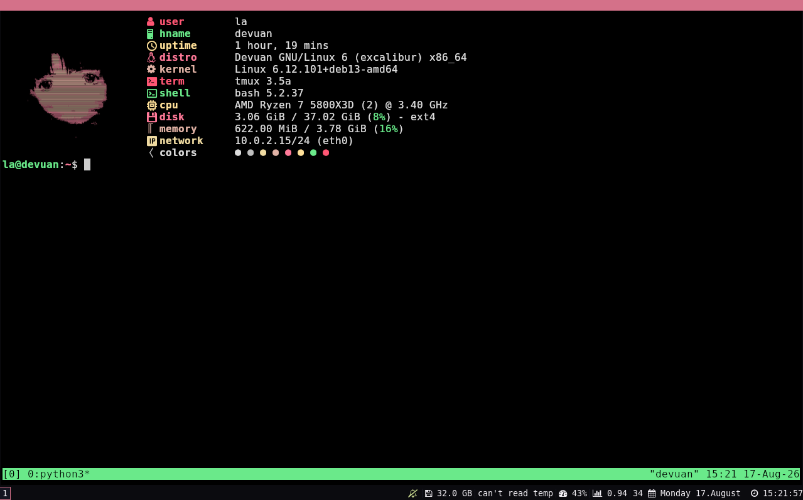
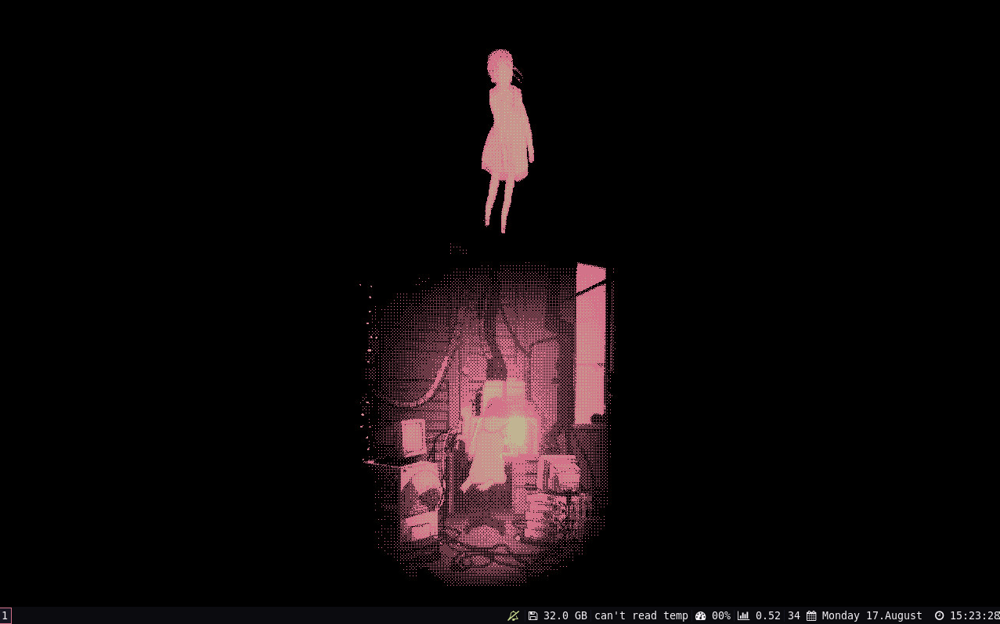

# Serial Experiments Lain Dotfiles (Debian-based)

## Project Structure
```
ddot-lain/
├── install.sh
├── LICENSE
├── README.md
└── .config/
```

## Preview
<div align="center">

</div>

## Requirements

This setup is intended for:

- Debian
- Debian-based Linux distributions
- A fresh or minimal installation
- An active internet connection
- A user account with `sudo` privileges

The installer uses `apt` to install the required packages.

## Included Packages

The installation script installs the following tools:

- `xorg` — graphical display server
- `i3` — lightweight window manager
- `i3status` — system information bar for i3
- `kitty` — terminal emulator
- `ranger` — terminal file manager
- `git` — version control system
- `feh` — image viewer and wallpaper setter
- `fonts-font-awesome` — icon fonts
- `dmenu` — application launcher
- `tmux` — terminal multiplexer

## Installation

Clone this repository:

```bash
git clone https://github.com/milkinit/ddot-lain.git && cd ddot-lain && ./install.sh
```
