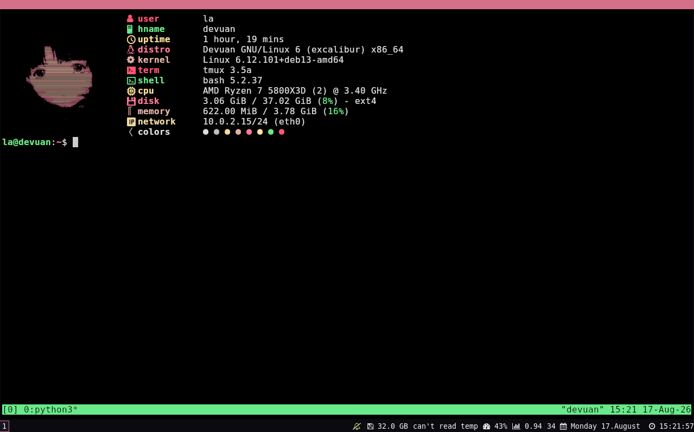
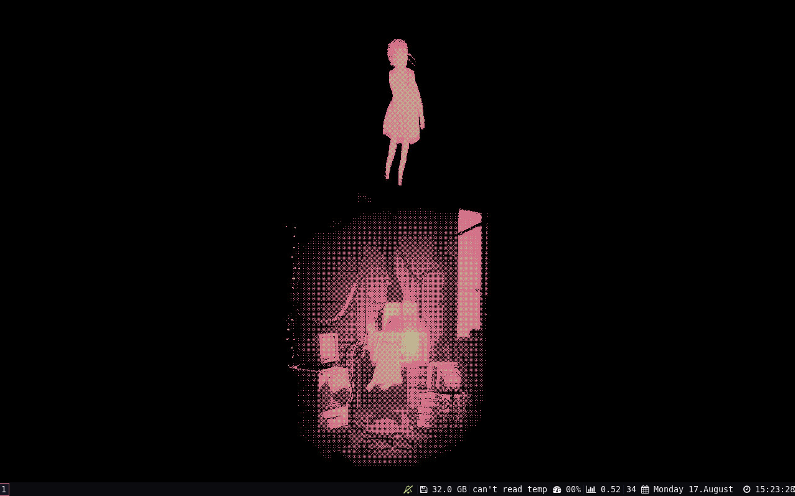

# Serial Experiments Lain Dotfiles

A lightweight Debian-based desktop environment inspired by *Serial Experiments Lain*.

This repository contains configuration files, themes, scripts, and tools for creating a minimal Lain-themed Linux setup using the i3 window manager.

## Project Structure
```
ddot-lain/
├── install.sh
├── LICENSE
├── README.md
├── .config/
└── grub-theme/
    ├── install.sh
    ├── theme.txt
    ├── background.png
    └── ...
```

## Features

- Lightweight Xorg desktop environment
- i3 window manager
- Lain-inspired terminal and desktop appearance
- Kitty terminal emulator
- Dmenu application launcher
- i3status system information bar
- Ranger terminal file manager
- Feh wallpaper support
- Installation script for Debian-based systems

## Preview



## Requirements

This setup is intended for:

- Debian
- Debian-based Linux distributions
- A fresh or minimal installation
- An active internet connection
- A user account with `sudo` privileges

The installer uses `apt` to install the required packages.

## Included Packages

The installation script installs the following tools:

- `xorg` — graphical display server
- `i3` — lightweight window manager
- `i3status` — system information bar for i3
- `kitty` — terminal emulator
- `ranger` — terminal file manager
- `git` — version control system
- `feh` — image viewer and wallpaper setter
- `fonts-font-awesome` — icon fonts
- `dmenu` — application launcher

## Installation

Clone this repository:

```bash
git clone https://github.com/milkinit/ddot-lain.git && cd ddot-lain && ./install.sh
```
